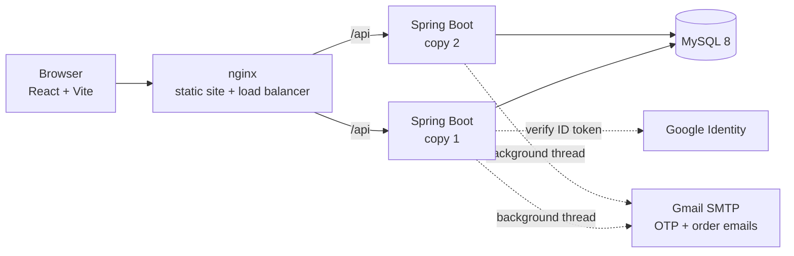

# Farm Fresh

[](https://github.com/nithishramurthy23/ms-harvests/actions/workflows/ci.yml)


An online store for fresh produce from farms in the Nilgiris. Customers browse products and ready-made baskets, sign in with a password, an email code or Google, and place cash-on-delivery orders that are confirmed with a one-time code.

It's a Spring Boot REST API with a React frontend. The backend runs as several stateless copies behind nginx, and it was load-tested with k6 to make sure it never oversells stock.

<!-- Screenshots: add images to docs/screenshots/ and uncomment.
| Home | Product | Checkout | Order history |
|---|---|---|---|
|  |  |  |  |
-->

## Highlights

- **No overselling under load.** Stock is reserved with one conditional `UPDATE ... WHERE stock >= qty` inside the order transaction. In a k6 flash sale with 500 buyers and 100 items across 2 backend copies, exactly 100 orders went through and stock ended at 0, in every run.
- **Found and fixed real bottlenecks.** Profiling with Java Flight Recorder showed about 20% of CPU going to rebuilding the JWT parser on every request. Combined with sizing Tomcat's threads to the DB pool, order-history p95 dropped from ~780 ms to ~350 ms and flash-sale errors went from up to 248 to 0. Details are in [loadtest/RESULTS.md](loadtest/RESULTS.md).
- **The server decides the price.** Totals are calculated from database prices and weekday discount rules, so a price edited in the browser is ignored.
- **OTP guesses can't be reset by a rollback.** The order OTP check commits in its own transaction, so a wrong guess still counts even when the order fails.
- **Access checks are tested.** Integration tests cover one customer trying to read or change another customer's orders.

The reasoning behind each choice, with the alternatives I considered and their tradeoffs, is in [docs/design-decisions.md](docs/design-decisions.md).

## Architecture



- Each backend copy is stateless. Logins use JWTs, so any copy can serve any request and copies can be added with `BACKEND_REPLICAS=4`.
- MySQL is the only shared state. Stock correctness relies on its row locks, not on Java locks, so it holds across copies.
- Emails go out on a background thread pool with timeouts, so a slow mail server doesn't hold up checkout.
- In production, Caddy sits in front for HTTPS and a backup container dumps the database daily ([docs/deployment.md](docs/deployment.md)).

## Tech stack

| Area | Tools |
|---|---|
| Backend | Java 17, Spring Boot 3.2 (Web, Data JPA, Security, Validation, Mail, Actuator), jjwt, Spring Security OAuth2 JOSE (Google ID tokens) |
| Frontend | React 18, Vite, Tailwind CSS, React Router, Axios |
| Database | MySQL 8 (H2 for tests) |
| Testing | JUnit 5, Mockito, Spring MockMvc, JaCoCo, Vitest, React Testing Library, k6 |
| DevOps | Docker, Docker Compose, nginx, Caddy, GitHub Actions |
| API docs | springdoc-openapi (Swagger UI) |

## API

With the backend running, interactive docs are at **http://localhost:8080/swagger-ui/index.html** (OpenAPI JSON at `/v3/api-docs`).

Endpoints marked 🔒 need an `Authorization: Bearer <jwt>` header.

| Method | Path | What it does |
|---|---|---|
| POST | `/api/auth/register` | Create an account (disabled until verified) and email a code |
| POST | `/api/auth/verify-otp` | Activate the account with the code, returns a JWT |
| POST | `/api/auth/resend-otp` | Send a new activation code |
| POST | `/api/auth/login` | Log in with password or email code, returns a JWT |
| POST | `/api/auth/send-otp` | Email a login code |
| GET | `/api/auth/google/config` | Whether Google sign-in is enabled, and the client ID |
| POST | `/api/auth/google` | Exchange a Google ID token for a JWT |
| POST | `/api/auth/forgot-password` | Email a password-reset code |
| POST | `/api/auth/reset-password` | Set a new password with the reset code |
| GET | `/api/auth/me` 🔒 | Current user's profile |
| PUT | `/api/auth/update-profile` 🔒 | Update name, phone and address |
| POST | `/api/orders/initiate-order` 🔒 | Email the order confirmation code |
| POST | `/api/orders/place-order` 🔒 | Place a cash-on-delivery order with the code |
| GET | `/api/orders/history` 🔒 | The user's orders |
| GET | `/api/orders/{orderId}` 🔒 | One order (only if it's yours) |
| POST | `/api/contact` | Send a message to the shop |
| GET | `/actuator/health` | Health check used by Docker and nginx |

<details>
<summary>Example: placing an order</summary>

```http
POST /api/orders/place-order
Authorization: Bearer eyJhbGciOi...
Content-Type: application/json

{
  "paymentMethod": "cod",
  "orderConfirmationOtp": "482913",
  "items": [{ "productId": 3, "quantity": 2 }],
  "shippingInfo": {
    "name": "Asha", "address": "12 MG Road", "city": "Bengaluru",
    "postalCode": "560001", "phone": "+91 98765 43210",
    "email": "asha@example.com", "expectedDeliveryDate": "2026-11-25"
  }
}
```

`201 Created`

```json
{ "orderId": 41, "status": "PENDING", "totalAmount": 398.00, "orderDate": "2026-11-21T13:52:10", "message": "Order placed successfully!" }
```

Wrong or expired code, unknown product or not enough stock returns `400` with a `message`.
</details>

## Quick start

You need Docker and a Gmail app password (for the OTP emails).

```bash
git clone https://github.com/nithishramurthy23/ms-harvests.git && cd ms-harvests
cp .env.example .env        # fill in DB_PASSWORD, JWT_SECRET, MAIL_USERNAME, MAIL_PASSWORD
docker compose up -d --build
```

Open http://localhost:8081. This starts MySQL (seeded with sample products), two backend copies and nginx.

To run without Docker, plus troubleshooting, every setting, and how to change products and prices, see the full **[setup guide](docs/setup.md)**. To deploy on a server with HTTPS and backups, see [docs/deployment.md](docs/deployment.md).

## Tests

```bash
mvn verify     # backend unit + integration tests (H2, no MySQL or mail needed), coverage in target/site/jacoco/
npm test       # frontend tests (Vitest + React Testing Library)
```

GitHub Actions runs both suites, the linter and the Docker image builds on every push and pull request. The k6 scenarios and how to run them are in [loadtest/](loadtest/README.md).

## Project layout

```
src/main/java/.../farm/fresh/   Spring Boot: controller, service, repository, entity, dto, securityconfig
src/test/java/                  backend unit and integration tests
src/ (pages, components, ...)   React app
Untitled.sql                    schema and sample data
deploy/                         nginx, Caddy and production compose file
docs/                           setup guide, design decisions, deployment, Google sign-in
loadtest/                       k6 scripts and results
```

## What's next

Flyway migrations, serving the catalogue from the API instead of the frontend's copy, an idempotency key on checkout, rate limiting on the OTP endpoints, and an admin screen for order status. The full list, in priority order, is at the end of [docs/design-decisions.md](docs/design-decisions.md#what-id-do-next).
